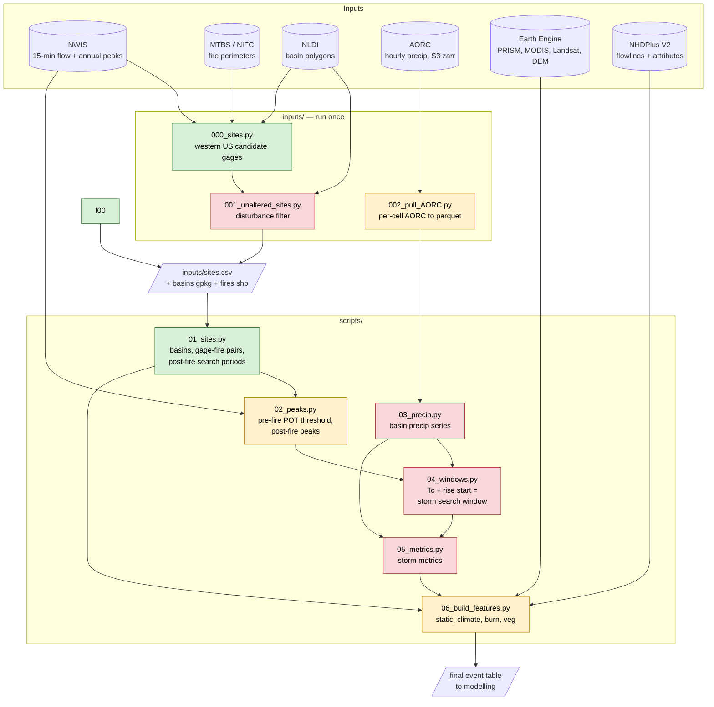

# Post Fire Peak Flow Identification, Storm Pairing, and Attribution

A pipeline for post-fire peak flow identification, storm pairing, and attribution with useful features for modelling 

This pipeline builds and **event table** for post-fire flood modelling with one row per post-fire peak flow at a gaged, burned watershed, paired with the storm that caused it and described by precipitation, watershed, climate, burn and vegetation attributes. The table is fed into a random forest (see the parent project at: ____) 

**Status (2026-11-18): under construction** 
This is not yet usable as it, though feel free to fork and adapt (or contribute!)

## Setup 
**1. Clone the repository** 
```bash
git clone ____LINK____
cd ____name____
```
**2. Create and activate the needed conda environment**
```bash
conda create -n _____ python = ???
conda activate 
conda install -r environmental.yaml 
``` 
**Authenticate with Google Earth Engine**
Head to config.yaml and enter a GEE project ID then run
```bash
earthengine authenticate
```


## Pipeline Process


## Layout 

The core modules live in firepeaks/, these modules are importable and used extensively in the scripts/, which is the actual pipeline that can be run-end to end. 

### Steps in scripts/ 

01_sites.py 
- input: a site list (gage IDs plus polygons), a MTBS perimeter 
- per-site values: area, the AORC cells, and a hash of the geometry 
- time of concentration: what method? will need flow path and slope 
- output: a parquet with one row per site and polygons in a gpkg linked by site ID 

02_peaks.py 
- peaks table, two different configs could live here 
1. Read a CSV of peaks you already have (such as the ~2,000 Haley already identified), date only peaks will need a different time precision (such as for those derived from literature or field observation)
2. Pull NWIS 15 min flow for the period, detect peaks over a threshold, place peaks atleast ___ apart, find each events start by walking back down the rising limb (same idea as RREDI's event start)

03_precip.py
- for each site, pull the AORC per-cell hourly stack over the union of all the event windows plus the antecedent lookack 
- cache it keyed on the geometry hash for calc's in next steps 

04_windows.py 
- search each peak backwards, and output a parquet of event, storm startm storm end, and other info 

05_metrics.py 
- within each events window, compute every temporal metric under every aggregation, then the spatial metrics 
- output the metrics w/ suffixes defining the aggregation method 

06_percentiles.py 
- calculate the percentile features with the long-term aggregation 

